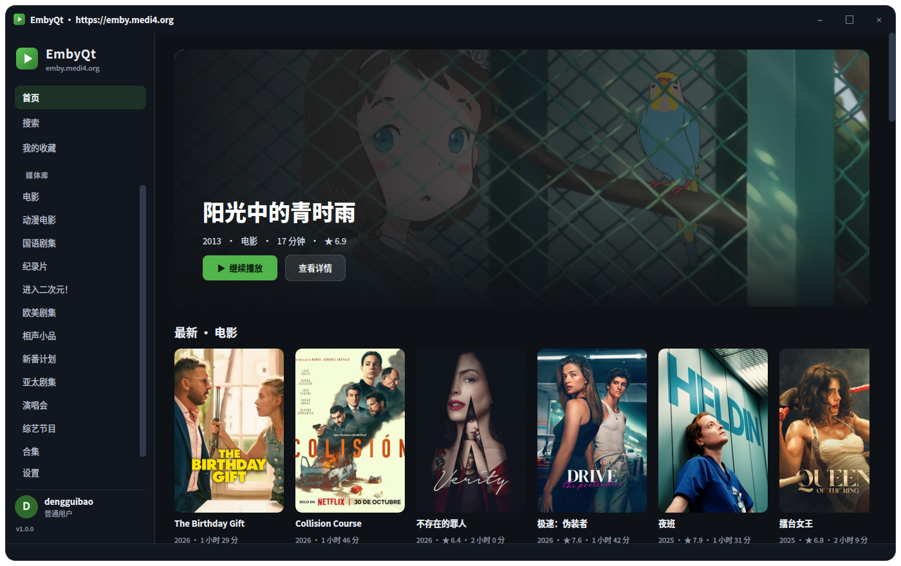
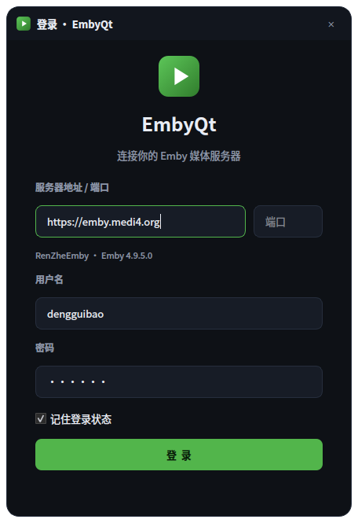
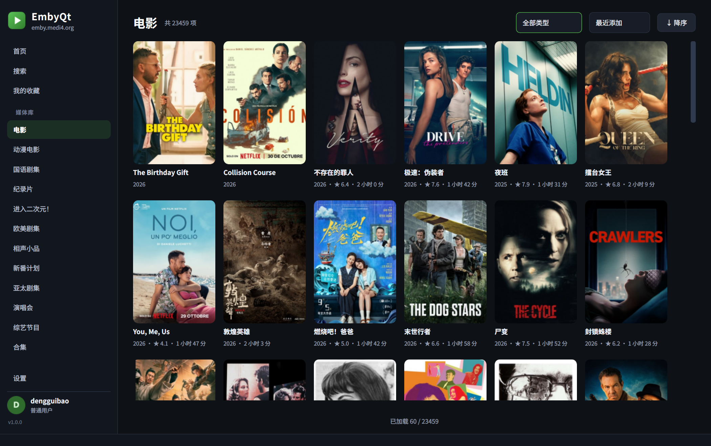
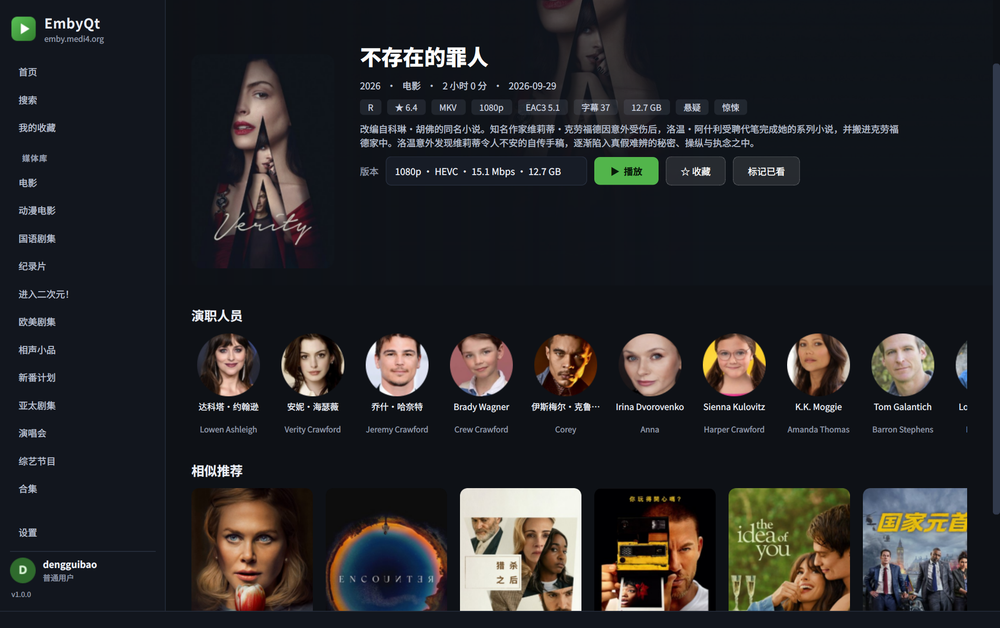
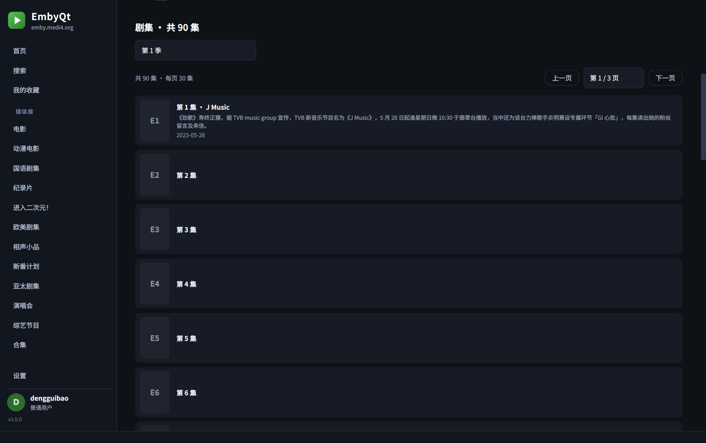
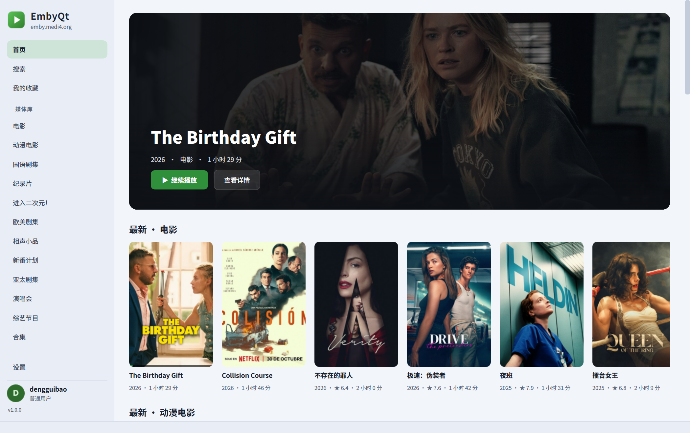
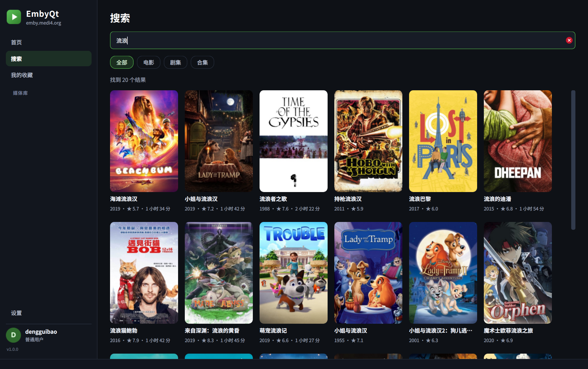
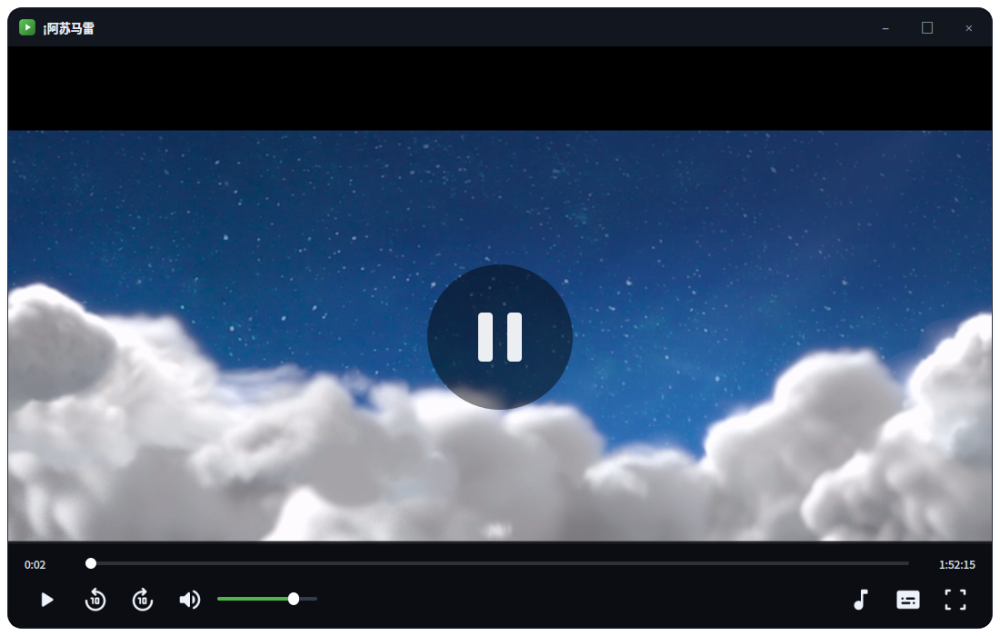

# WhalePlayer —— Emby 桌面客户端

基于 Emby REST API 的 Linux 桌面客户端，PySide6（Qt 6）+ libmpv（保留 libVLC 回退）。
界面为深色媒体中心风格：侧边栏媒体库、海报墙、详情页、内嵌播放器。

> 项目架构、模块说明、维护与 AI 协作文档见 **[docs/README.md](docs/README.md)**。



## 一、服务器分析（emby.medi4.org）

在开发前对该服务器做了探测，结论直接决定了客户端的设计。

| 项目 | 结果 |
| --- | --- |
| 服务器 | `RenZheEmby`，Emby **4.9.5.0**，ID `9d3516efb5924a49885eabfff0af666d` |
| 接入层 | Cloudflare（`server: cloudflare`） |
| 客户端限制 | **按客户端名/UA 白名单**，不在名单内返回 403 `请使用群公告中允许的客户端进行访问` |
| 账号 | `dengguibao`，普通用户（非管理员） |
| 播放策略 | `EnableMediaPlayback=true`，但**视频转码、音频转码、Remux、下载全部关闭** |
| 限速/并发 | `RemoteClientBitrateLimit=0`、`SimultaneousStreamLimit=0`（未限制） |
| 媒体库 | 12 个（电影 / 动漫电影 / 国语剧集 / 纪录片 / 欧美剧集 / 综艺 / 合集等） |
| 规模 | 「电影」约 2.4 万项；「国语剧集」6,157 部；合计可检索条目 4 万+ |
| 媒体形态 | 大量 `.strm` 文件，指向服务器本机的 HTTP 源（`127.0.0.1:8080`） |

### 关键限制与应对

1. **Cloudflare 客户端白名单**
   - 被拒绝：`Infuse`、`Fileball`、`Senplayer`、`VidHub`、`Kodi`、`Jellyfin`、`okhttp`、`curl`（无自定义头）…
   - 被放行：`Emby for Android`、`Emby Web`、`Emby for iOS`、`Emby Theater`、`Emby for Apple TV`、`Emby`、`Hills`、`Yamby`
   - 应对：所有 API 请求都携带
     `X-Emby-Authorization: MediaBrowser Client="Emby for Android", Device=…, DeviceId=…, Version=…, Token=…`。
   - 只带 `?api_key=` 的媒体请求同样会被 403，所以播放地址必须带白名单 UA（见下）。

2. **账号禁止转码 —— 只能 DirectPlay**
   - `POST /Items/{id}/PlaybackInfo` 返回 `SupportsTranscoding=false`，只有直连/直连串流可用。
   - 播放器因此不做任何转码请求，直接以 HTTP Range 拉取原文件字节，交给 libmpv 解码。
   - 目录里以 H.264/HEVC + AAC/EAC3 为主，libmpv 可软解；极端编码（如缺少解码器）无法播放属预期。

3. **媒体流的鉴权方式**
   - 实测 `GET /Videos/{id}/stream?static=true&MediaSourceId=…&api_key=…` 支持 `Range`（206），
     但请求必须携带白名单标识：
     - 带 `X-Emby-Authorization` 头 → 放行；
     - 或 UA 为 `Emby for Android` / `VLC/… LibVLC/…` 等白名单值 → 放行；
     - 仅 `api_key` + 浏览器/curl UA → 403。
   - 客户端默认使用 **直连 + 媒体选项 `:http-user-agent=Emby for Android`**；
     若直连失败，自动回退到本机回环代理（注入认证头）重试。

4. **图片接口无鉴权**
   - `/Items/{id}/Images/Primary|Backdrop` 匿名可访问，因此海报用 `QNetworkAccessManager`
     异步加载并落盘缓存，不影响 API 鉴权。

5. **播放状态上报可用**
   - `POST /Sessions/Playing`、`/Sessions/Playing/Progress`、`/Sessions/Playing/Stopped`
     均返回 204，客户端据此实现进度记忆、继续观看、看完自动标记。

## 二、功能

- **登录**：服务器地址 + 端口（可选，地址里带端口会自动拆分）、自动探测服务器名与版本、
  记住登录态（只保存 Token，不保存密码）。
- **首页**：焦点横幅、继续观看、各媒体库「最新」横向列表；每个横向分类左右两侧有翻页箭头，点击平滑左右滚动。
- **媒体库**：海报墙、滚动到底自动加载、按名称/最近添加/年份/评分排序、类型筛选、共 N 项计数。
- **详情**：背景大图、海报、评分/类型/编码信息、简介、演职人员（圆形头像）、相似推荐；
  剧集支持季切换，分集列表**每页 30 集**、上下两组翻页器可跳页，并自动定位到未看剧集。
- **资源版本**：同一部影片有多个版本（4K / 1080P / 720P 等）时，详情页显示「版本」下拉框，
  标注分辨率、编码、码率、体积；播放按所选版本进行，只有一个版本时自动隐藏。
- **网络与代理**：跨平台自动跟随系统代理（`EMBYQT_PROXY` > `urllib.getproxies()` 标准入口 >
  Linux GNOME/KDE 桌面代理，macOS 补充 `scutil --proxy` 的 PAC），有代理时 API、海报、播放流全部经代理，没有则一律直连。
  代理状态**每个请求前都会复查**（2 秒 TTL），用户中途开启/关闭系统代理无需重启；
  开始播放和登录时会强制刷新。「设置」页显示当前生效代理，连接失败/超时/代理异常均有中文提示。
- **缓冲大小**：「设置 → 缓冲大小」可选 100M / 500M / 1G / 2G / 不限（libmpv 下次播放生效）。
- **主题**：「设置 → 主题」提供 **跟随系统 / 深色 / 浅色** 三档，运行中即时生效并持久化。
  跟随系统使用 Qt 的 `colorScheme`（Windows/macOS/Linux 原生），无法读取时回退到系统调色板亮度；
  系统主题变化会自动切换。也可用 `EMBYQT_THEME=dark|light` 临时覆盖。
- **用户菜单**：侧边栏左下角点击用户名弹出「设置 / 退出登录」，设置不再占用侧边栏导航项。
- **无边框窗口**：隐藏系统标题栏，使用自绘标题栏（可拖动、双击最大化、最小化/关闭/最大化），
  窗口四角统一为 **16px 圆角**；最大化/全屏时自动切平角并铺满屏幕。主窗口、登录框和播放器统一风格，
  播放器窗口化时视频底部按 16px 圆角裁剪。
- **播放**：libmpv 默认播放内核（Wayland 使用 Qt OpenGL render API），libVLC 作为回退；
  直连播放原文件，断线自动回退代理；支持进度条拖动、±10 秒、
  音量/静音、音轨切换、内嵌/外挂字幕选择、全屏、剧集自动连播；进度条支持点击/拖动定位，并用灰色区间显示 libmpv 的 `seekable-ranges`，控制栏显示「当前缓存 / 目标缓存」时长；缓冲时长按「配置大小 / 影片大小 × 影片时长」换算；不限时缓存整部影片；
  `EMBYQT_MPV_CACHE_SECS` 只在无法获取影片大小时兜底；跳转到未缓冲位置后缓冲区间会从新位置重新统计；单击视频画面暂停/继续，双击全屏。
  控制栏使用 Material Symbols 图标并跟随深/浅色主题；加载中显示转圈和实时网速，音量图标悬停弹出音量滑条，音量右侧显示带图标的实时网速；暂停时画面正中显示半透明暂停图标；
  标题栏提供窗口最大化；片名与关闭按钮已移除（关闭走标题栏）。
  窗口模式下播放时，控制栏与进度条在鼠标 10 秒无操作后自动隐藏（全屏 2.6 秒），
  移动鼠标或点击画面即可恢复，避免遮挡字幕。
  **全局唯一播放器**：无论在首页、详情还是剧集里点播，都复用同一个播放窗口；
  点播新视频时在窗口内直接切换，不会重复弹窗。
- **进度同步**：开始播放、每 10 秒、暂停/拖动、退出时上报 Emby；播放到 90% 自动标记已看。
- **日志**：「设置 → 日志」可开关日志、选择 `INFO`/`DEBUG` 级别，默认开启、默认 `DEBUG`（发版前）。
  日志同时输出到终端和轮转文件（Linux `~/.local/state/embyqt/logs/embyqt.log`、
  macOS `~/Library/Logs/embyqt/`、Windows `%LOCALAPPDATA%\embyqt\logs\`），
  覆盖登录、代理、请求、播放、页面切换等业务事件，不会记录密码或 token。
- **搜索**：全局搜索（电影/剧集/单集/合集），可切换类型，输入防抖。
- **收藏**：右侧栏「我的收藏」。
- **交互**：单击打开详情、双击直接播放、右键菜单（播放 / 详情 / 标记已看 / 收藏）。
  首页/详情横向列表：默认普通滚轮让整页上下滚动，Shift + 滚轮（或触控板左右滑）横向浏览；
  可在「设置 → 鼠标滚轮」改为普通滚轮直接左右滚动分类。

### 界面预览

| 登录 | 媒体库 |
| --- | --- |
|  |  |

| 影片详情（含版本选择） | 剧集详情 |
| --- | --- |
|  |  |

| 浅色主题 | 搜索 |
| --- | --- |
|  |  |

| 播放器 |
| --- |
|  |

## 打包二进制

使用 PyInstaller 打包为 Linux 可执行文件：

```bash
./scripts/build_binary.sh              # 目录版，自动携带系统 libVLC
./scripts/build_binary.sh --onefile    # 单文件版
./scripts/build_binary.sh --system-vlc # 不携带 libVLC，目标机器需安装 VLC
```

产物：

- 目录版：`dist/WhalePlayer/WhalePlayer`
- 单文件：`dist/WhalePlayer`

默认会自动查找系统 `libvlc.so.5`、`libvlccore.so.9`、VLC plugins 和 `libmpv.so.2` 并打入产物；
`--system-vlc` 可减小 VLC 部分体积，但运行环境需安装 VLC/libVLC。

### 桌面启动器

已提供：

- `packaging/whaleplayer.desktop`：`Exec=/opt/WhalePlayer/WhalePlayer`
- `packaging/whaleplayer.png`：256×256 应用图标

安装到 `/opt/WhalePlayer` 后：

```bash
sudo mkdir -p /opt/WhalePlayer
sudo cp -a dist/WhalePlayer/. /opt/WhalePlayer/
sudo cp packaging/whaleplayer.png /opt/WhalePlayer/whaleplayer.png
sudo cp packaging/whaleplayer.desktop /usr/share/applications/whaleplayer.desktop
sudo update-desktop-database /usr/share/applications
```

## 三、安装与运行

系统依赖：Python 3.10+、libmpv（Ubuntu/Debian 包名 `libmpv2`）、
libVLC 3（回退用，包名 `vlc` 或 `libvlc5`）、
Qt 的 xcb 后端（`libxcb-cursor0`，仓库 `vendor/lib` 已附带一份备用的
`libxcb-cursor.so.0`，`run.sh` 会自动加入 `LD_LIBRARY_PATH`）。

```bash
cd emby-qt
python3 -m venv .venv
.venv/bin/pip install -r requirements.txt
./run.sh
```

也可以直接：

```bash
PYTHONPATH=. QT_QPA_PLATFORM=xcb .venv/bin/python -m embyqt
```

首次启动输入服务器地址、用户名、密码即可；成功后 Token 保存在
`~/.config/EmbyQt/EmbyQt.conf`（沿用旧设置路径以保留登录态）。退出登录会清除 Token。

可选环境变量：

```bash
EMBYQT_THEME=light|dark     # 强制浅色/深色（默认跟随系统）
EMBYQT_PROXY=http://host:port  # 强制指定代理；=none 强制直连
EMBYQT_FORCE_X11=1          # 让界面走 X11（仅在 X11 桌面可用时）
```

### 快捷键

| 按键 | 功能 |
| --- | --- |
| `Ctrl+F` | 打开搜索 |
| `Ctrl+H` | 回到首页 |
| `Alt+←` | 详情页返回 |
| `Space` | 播放 / 暂停 |
| `←` / `→` | 后退 / 前进 10 秒 |
| `↑` / `↓` | 音量 ±5 |
| `M` | 静音 |
| `F` | 全屏切换 |
| `Esc` | 退出全屏 / 关闭播放器 |

## 四、项目结构

```
embyqt/
├── api.py           # Emby REST 封装（认证、媒体库、播放上报、直连地址）
├── streamproxy.py   # 本机回环流代理（注入认证头，作为直连兜底 / 外挂字幕）
├── net.py           # 系统代理探测（EMBYQT_PROXY / 环境变量 / macOS scutil / GNOME/KDE）
├── player.py        # libVLC 回退封装 + 后台播放上报队列
├── mpv_player.py    # libmpv 内核 + Qt OpenGL render API
├── config.py        # QSettings 登录态与偏好
├── context.py       # 全局上下文：客户端、代理、图片加载器
├── imagecache.py    # 异步图片加载、圆角处理、内存 LRU + 磁盘缓存
├── async_task.py    # QThreadPool 异步调用，回调回 GUI 线程
├── ui/
│   ├── login.py     # 登录窗口
│   ├── mainwindow.py# 侧边栏 + 页面堆栈
│   ├── home.py      # 首页 / 焦点横幅
│   ├── library.py   # 媒体库海报墙
│   ├── detail.py    # 影片 / 剧集 / 合集详情
│   ├── search.py    # 搜索
│   ├── settings.py  # 设置
│   ├── playerwindow.py # 播放器窗口
│   ├── widgets.py   # 流式布局、海报卡、剧集行等
│   └── theme.py     # 深色主题 QSS
└── main.py          # 入口（登录态恢复 / 退出登录循环）
```

### 设计要点

- **全部网络请求走线程池**，UI 不阻塞；图片**按可见性懒加载**（绘制时才发起请求），
  避免一次打开媒体库时并发拉取上百张海报。
- **海报网格**使用流式布局，随窗口宽度自动换行；横向列表支持滚轮左右滚动。
- **主题**使用两套调色板生成 QSS，组件通过 `objectName` 取色，自定义绘制的组件在重绘时读取
  当前调色板；系统 `colorSchemeChanged` 触发后即时切换，无需重启。
- **窗口**采用 `FramelessWindowHint` + 自绘标题栏；圆角由窗口级 QSS 绘制，边缘通过透明热区
  调用 `startSystemResize` 交给窗口管理器缩放，最大化时自动去掉圆角与外边距。
- **代理**由 `embyqt/net.py` 的 `ProxyManager` 统一管理，`EmbyClient`（requests）、
  海报（`QNetworkProxyFactory` 每个请求动态返回代理）、播放流（本机回环代理内部转发）
  共用同一份状态，保证「有代理全走、没代理全不走」。
  - 探测走跨平台标准入口：Linux 环境变量、Windows 注册表、macOS SystemConfiguration，
    Linux 再补充 GNOME（手动/PAC）和 KDE 配置，macOS 再补充 `scutil --proxy` 的 PAC；
  - 每个请求前调用 `current()`，带 2 秒 TTL，兼顾实时性与 gsettings 子进程开销；
  - 代理变化会写入代理日志；
  - 使用系统代理时，播放器固定走本机代理（不再直连），避免绕过代理。
- **播放器**按平台选择渲染方式：
  - X11（`xcb`）：libVLC 通过 `set_xwindow` 直接嵌入原生窗口，控制栏同为原生子窗口；
  - macOS：统一走 vmem 内存渲染，避免 NSView 原生窗口无法参与 Qt 圆角裁剪；
  - Wayland：libVLC 3 无法嵌入原生窗口，改用 **vmem 内存渲染**（RV32 帧 → QImage），
    由 Qt 在窗口内绘制，仍是单窗口体验，控制栏用普通子控件覆盖。
  - Linux 下绝不能用 `set_hwnd`（Windows 路径），它会在 X11 上把 vout 置为 `none`，
    表现为「有进度有声音、没有画面」。
- **播放中断保护**：使用最后播放位置判断异常结束，
  距结尾不足 92% 时视为异常，自动尝试代理重连而不是退出。

## 五、测试

```bash
# 单元测试（无网络）
PYTHONPATH=. .venv/bin/python -m unittest discover -s tests -v

# 服务器能力探测（需要账号）
EMBY_SERVER=https://emby.medi4.org EMBY_USER=xxx EMBY_PASS=xxx \
  .venv/bin/python scripts/check_server.py

# UI 冒烟 + 截图（EMBY_USER / EMBY_PASS 为测试账号）
EMBY_USER=xxx EMBY_PASS=xxx PYTHONPATH=. .venv/bin/python scripts/smoke_ui.py

# 播放冒烟（建议在 X11 下运行）
EMBY_USER=xxx EMBY_PASS=xxx PYTHONPATH=. QT_QPA_PLATFORM=xcb \
  .venv/bin/python scripts/smoke_player.py
```

## 六、常见问题

**代理是怎么判断的？**

按顺序取第一个有效配置：`EMBYQT_PROXY` → `urllib.request.getproxies()`（Linux 环境变量、
Windows 注册表、macOS 系统配置）→ macOS 的 `scutil --proxy`（PAC）→ Linux 的 GNOME（手动/PAC）或 KDE 配置。
读到代理后，API、海报、播放流全部使用它；没有读到就直接连接。

代理状态不是只在启动时判断：每个网络请求前都会复查（2 秒缓存），
中途开关系统代理会自动生效。
可在「设置 → 系统代理」查看实际生效值。

**主题没有跟随系统？**

系统需提供 `colorScheme`（GNOME/KDE 均支持）。也可以用 `EMBYQT_THEME=light`
或 `EMBYQT_THEME=dark` 强制指定。

**执行 `./run.sh` 后好像卡住了 / 看不到窗口？**

终端会立即输出：

```
[WhalePlayer] 显示后端：wayland      # 或 xcb
[WhalePlayer] 已打开主窗口：<服务器>  # 或 [WhalePlayer] 打开登录窗口
```

窗口是**先创建、再后台校验登录态**的，即使服务器很慢也会马上出界面。

如果终端有输出但仍看不到窗口，通常是 `QT_QPA_PLATFORM` 指向了一个不显示的 X 服务
（本机 `DISPLAY=:0` 就不是桌面所用的显示）。本程序默认使用 Qt 原生 Wayland，
不要强制 `QT_QPA_PLATFORM=xcb`；需要 X11 原生嵌入时可显式：

```bash
EMBYQT_FORCE_X11=1 ./run.sh
```

**首页提示加载失败？**

点首页上的「重试」按钮，或到「设置 → 重新登录」。

## 七、已知限制

- 账号无转码权限：只支持 DirectPlay，编码不受客户端支持时无法播放（不提供转码降级）。
- Wayland 下视频经内存渲染后由 Qt 绘制，4K 高码率片源会比 X11 原生嵌入更吃 CPU；
  若你的桌面 X11 可用，可设 `EMBYQT_FORCE_X11=1` 走原生嵌入。
- 服务器在 Cloudflare 后，首次播放/加载海报可能有 1–3 秒延迟，属网络链路原因。
- 登录态以明文形式保存在 QSettings（仅 Token，不含密码），请自行注意本机安全。
- 暂未实现：弹幕、下载缓存、直播电视、多用户切换、播放列表管理。

## 八、许可

仅供个人学习与自用；请遵守所在服务器与内容提供方的使用条款。

播放器控制栏图标来自 **Google Material Symbols Rounded**（Apache License 2.0），
已内置于 `embyqt/assets/icons/`，许可文本见该目录下的 `LICENSE` 与 `NOTICE`。


## 单独打开播放器

不启动主界面，只打开播放器窗口：

```bash
.venv/bin/python scripts/player_only.py <item_id> [start_seconds]
```

脚本复用已保存的登录 Token；需要先在 WhalePlayer 中登录过一次。
